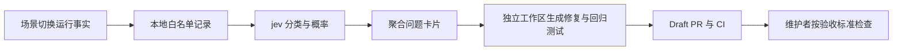

# 场景切换的 jev 改进闭环

这里的 jev 指便宜、快速、供软件调用的决策模型。第一版用
[`gpt-6-luna` Decisions API](https://developers.openai.com/api/docs/guides/decisions)
判断一次场景切换是否值得调查、可能属于哪个层、调查优先级。
模型不参与 DNS、路由、连接、取消或提交裁决。



## 启用

App 自动记录观察；云端模型和 GitHub 操作由开发机上的独立 worker 执行。先构建、按正常安装流程
安装含此改动的 Debug。worker 不会安装、启动、重启 App，也不更改系统网络。

需要 Python 3.9+、已认证的 `gh` 和已通过 `codex login` 配置的 Codex CLI。
将 `OPENAI_API_KEY` 通过启动终端的环境提供给 worker；不要把密钥写入仓库、验收文件或聊天。
修复 Agent 使用 Codex 自己的登录，不继承此 API key 或 GitHub token；不加载用户 Codex 配置，
执行环境为 `workspace-write`，工具网络关闭。

在仓库根目录运行：

```sh
# 一次性处理，只生成本地卡片。
python3 scripts/jev_loop.py

# 持续处理，自动创建 GitHub 问题卡片和修复 Draft PR。
make jev-loop
```

退出 worker 用 Ctrl-C。没有安装开机任务或云端服务。没有 API key 时仍保留本地问题卡片，
`--publish` 仍可发布脱敏事实，但不生成模型判断或自动修复。不要为测试闭环制造公开事故；
离线测试已使用模拟服务覆盖模型、卡片和修复调度。

默认读取 `~/Library/Logs/XDial Debug/jev/scenario-switch-observations.json`。
Next、正式版分别使用 `XDial Next`、`XDial` 日志目录，可显式指定：

```sh
python3 scripts/jev_loop.py --watch --publish --repair \
  --observations "$HOME/Library/Logs/XDial Next/jev/scenario-switch-observations.json" \
  --state-dir build/jev-next
```

同一状态目录只有一个 worker。默认目标仓库为 `kafeifei/XDial`，可用 `--repo owner/repo`
指定；修复前必须与 `origin` 推送地址匹配。

## 维护者在哪里把关

在 [scenario-switch-acceptance.json](../verification/scenario-switch-acceptance.json)
填写 `criteria`，并将 `status` 改为 `defined`。初始为 `pending`，不会替用户编造产品验收标准。
可使用 `--acceptance /path/to/private.json` 指定私有文件。标准原文仅留在本地卡片，不发给模型、
修复 Agent 或 GitHub Issue。若直接修改仓库内的文件并提交，Git 仍会正常公开其内容。

每个修复 PR 保持 Draft，由维护者检查事实、代码、回归测试、CI 和真实切换结果后决定是否接受、
合入或发布。`defined` 仅表示标准已填写。CI 通过、模型高概率和 Provider 报告 active 都不代表
真实业务流量已经验收通过。

## 记录和证据边界

- Host 从现有切换投影旁路记录开始、取消、协调结果、终态和前置拒绝，后台串行写盘。
  一次事务最多保留 20 个状态变化，文件最多 200 次尝试；目录权限 `0700`、文件 `0600`。
- 模型和公开卡片只收到固定枚举、布尔值、时长、失败任务种类、构建通道、构建号和源码提交号。
  不发送 Profile、原始错误文本、场景名/ID、事务 ID、配置指纹、SSID、DNS、IP 或 Underlay。
- `reconciling`、取消确认、超时不会被推断成回滚成功。长时间没有新终态的记录可以生成
  “结果未知”的卡片；它不证明连接已断，也不证明旧连接仍可用。
- 成功与正常取消同样进入模型观察。失败、超时、拒绝、中断和超过 120 秒未更新的未决事务
  即使暂时无法调用模型，也有本地卡片。模型概率至少 `0.7` 才会触发自动修复尝试。
- `build/jev-loop/state.json` 保存输入摘要、分类、概率分布、模型版本、问题版本及摘要、
  延迟、输入 token 数、预算、Issue 和 PR 状态；`cards/` 保存 JSON 和 Markdown。
  这些均为开发机产物，不提交入库。观察文件损坏时不会覆盖原文件；单条格式异常不会挡住其余记录。

## 去重、预算与修复范围

卡片按状态、active 关系、候选状态、错误码和失败任务种类聚合；相同签名只关联一个 Issue
和一条修复分支。已关闭 Issue 不重开，既有 PR 不重复创建，也不重写维护者的注释。
本地卡片保留最近事实及出现次数，公开 Issue 保留首次快照；后续观察不自动覆盖其正文。

默认每个 UTC 日最多 100 次模型请求、10 次卡片发布尝试、3 次修复尝试，可分别用
`--max-decisions`、`--max-cards`、`--max-repairs` 下调。预算先持久化再执行外部调用。
模型错误最多重试三次并退避，GitHub 错误退避重试；成功的模型判断在重启后不重复计费。
最多保留 200 个问题分组，达到上限会提示先归档状态和卡片，再使用新状态目录。

修复以最新 `origin/main` 为基线，放在 `build/jev-loop/worktrees/<signature>`，不修改当前
开发分支。父进程检查工作区和暂存区，最多 12 个 Swift/Go 文件、800 行改动，必须带测试文件，
拒绝符号链接、二进制、工作流、验收文件、权限和构建配置变更。没有可证明的缺陷可以不产出 PR。
通过差异格式与公开内容检查后推送 `jev/scenario-switch/<signature>` 并创建 Draft，完整 CI
随后由现有 PR 流程执行。系统不自动合并、关闭问题、安装或发布修复。

推送成功但 PR 创建暂时失败时，保留 `awaiting_pr` 状态，核对远端仍是已验证的提交后，
每隔 120 秒重试补建 Draft，最多三次，不重新运行修复 Agent。
修复失败、进程中断或已有工作区时保留现场，状态为 `needs_developer_review` 或 `running`，
不会无限重试。查看对应工作区、修复摘要及 `state.json`；确认现场已处理后，才清除该分组的
`repair` 状态并归档/移除旧工作区以重新尝试。补建 PR 重试耗尽时可检查远端分支后人工补建。
不要直接删除所有状态，否则会丢失预算和去重记录。

## 验证

```sh
make test-jev-loop
make test-macos-transaction MACOS_TEST_XCODEBUILD_FLAGS=CODE_SIGNING_ALLOWED=NO
make app-debug
```

Python 测试不调用真实模型或 GitHub；覆盖请求/响应格式、脱敏、恶意结构、正常负样本、
取消与未知结果、预算、退避、重启、去重、关闭问题、暂存区保护和 Draft 限制。
Swift 测试覆盖旁路记录的脱敏、状态合并、有界历史、重启持久化及权限。
